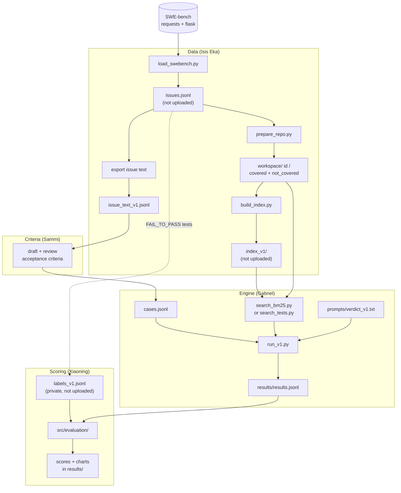
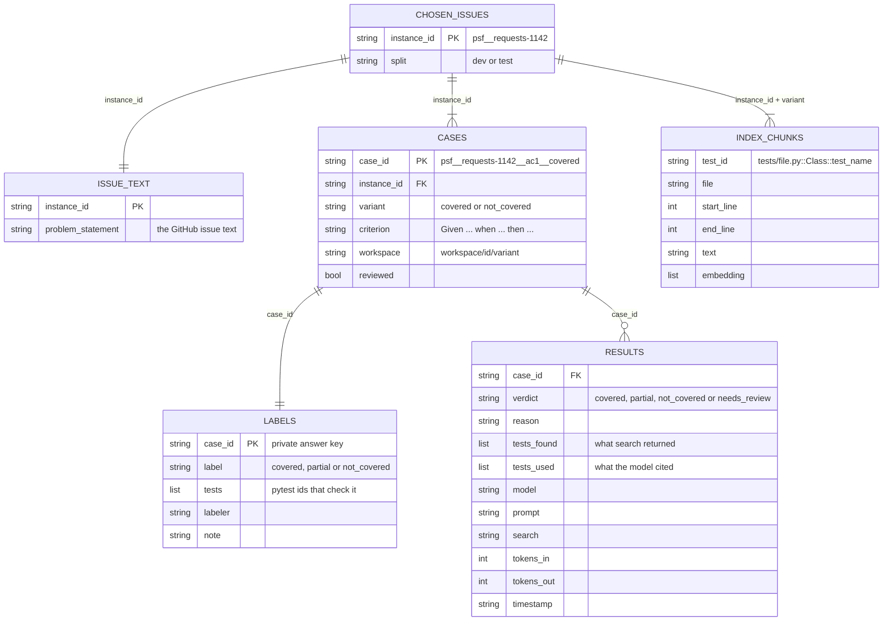

# Architecture

How version 1 fits together: which script makes which file, and who owns each step.
The diagrams are [Mermaid](https://mermaid.js.org/): GitHub draws them from the text below, so
edit the text to change them.

## Pipeline

The answer key (`labels_v1.jsonl`) only flows into scoring. It never reaches the criteria
step, the search or the model.

## Data model

One row per line in each `.jsonl` file. `case_id` links a case, its answer and its results.

`LABELS` shows the planned one-row-per-criterion format. Until Sammi's criteria are in,
`labels_v1.jsonl` still has one row per issue and variant (`psf__requests-1142-covered`).
`INDEX_CHUNKS` is one file per issue and variant: `data/index_v1/<id>__<variant>.jsonl`.
