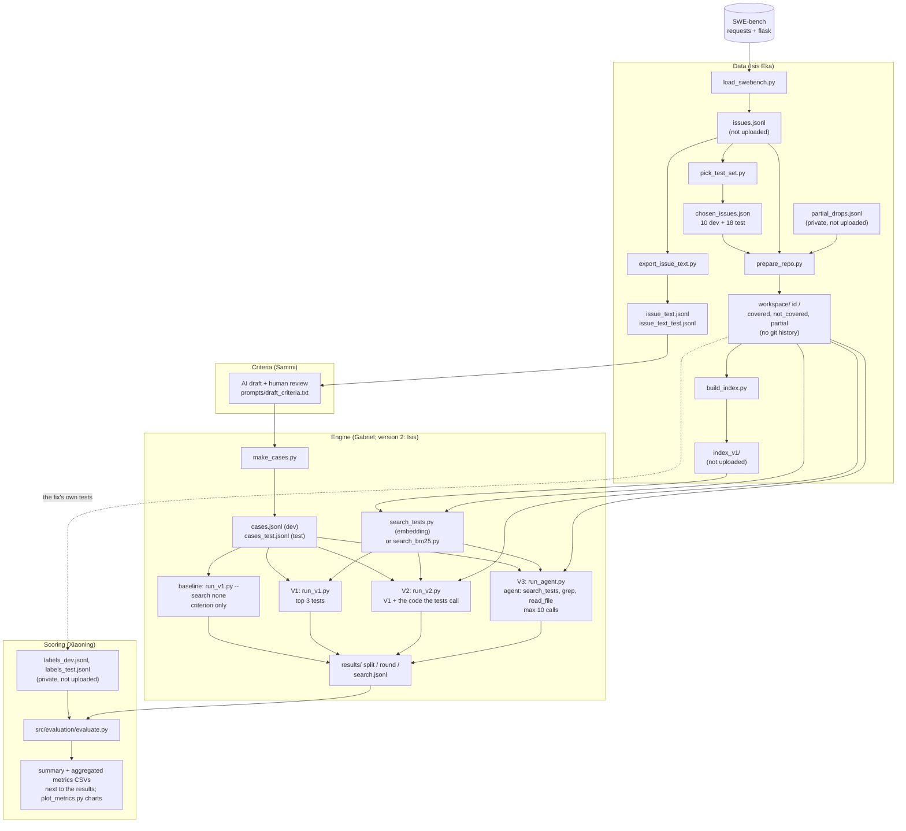
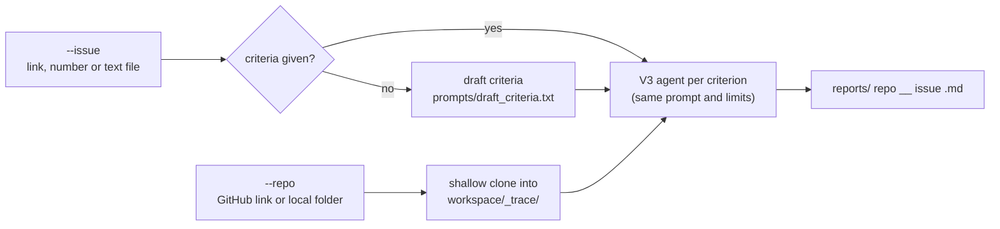
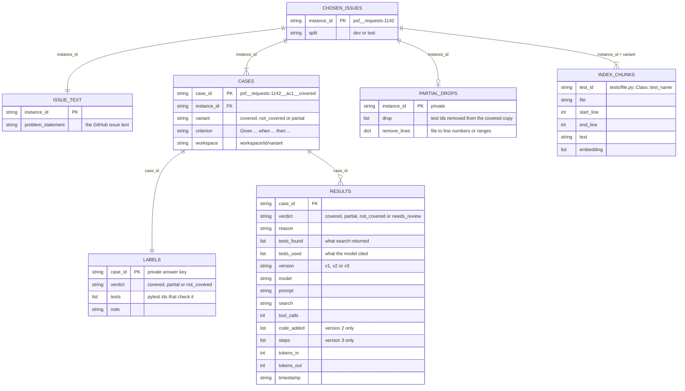

# Architecture

How the project fits together: which script makes which file, and who owns each step.
It covers the evaluation (no-retrieval baseline and versions 1–3 on the dev and test sets) and the
end-user tool `trace.py`. The diagrams are [Mermaid](https://mermaid.js.org/): GitHub draws them
from the text below, so edit the text to change them.

## Pipeline

The answer keys (`labels_dev.jsonl`, `labels_test.jsonl`) and the partial drop list only flow into
scoring and `prepare_repo.py`. They never reach the criteria step, the search or the model. Prompts
live in `prompts/` (`no_retrieval_v1`, `verdict_v1`, `verdict_v2`, `agent_v1`) and are frozen since
31 Oct.

## The end-user tool

`trace.py` reuses version 3 on any repository, outside the evaluation (decision 15). It never
reads `data/` and writes nothing to `results/`.

## Data model

One row per line in each `.jsonl` file. `case_id` links a case, its answer and its results.

`LABELS` replaced the first key, `labels_v1.jsonl` (one row per issue and copy), on the dev set
(decision 17); the test set uses `labels_test.jsonl` in the same format. `INDEX_CHUNKS` is one file
per issue and variant: `data/index_v1/<id>__<variant>.jsonl`.
