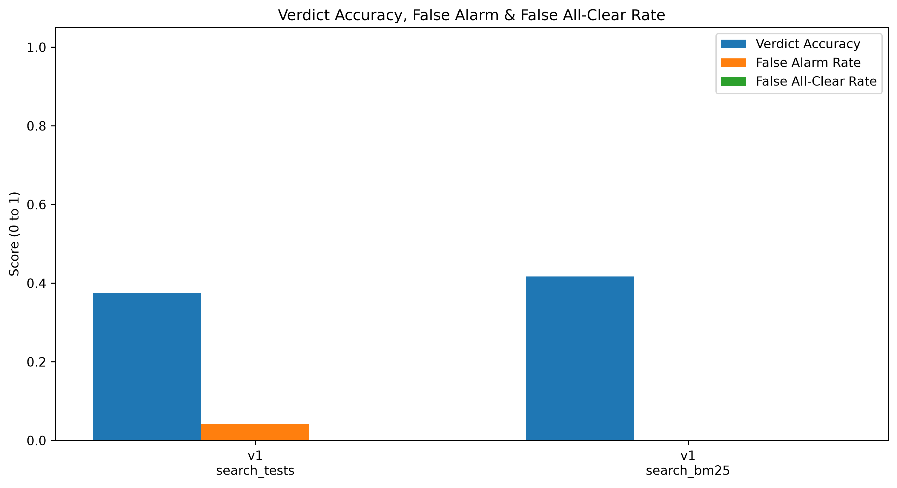
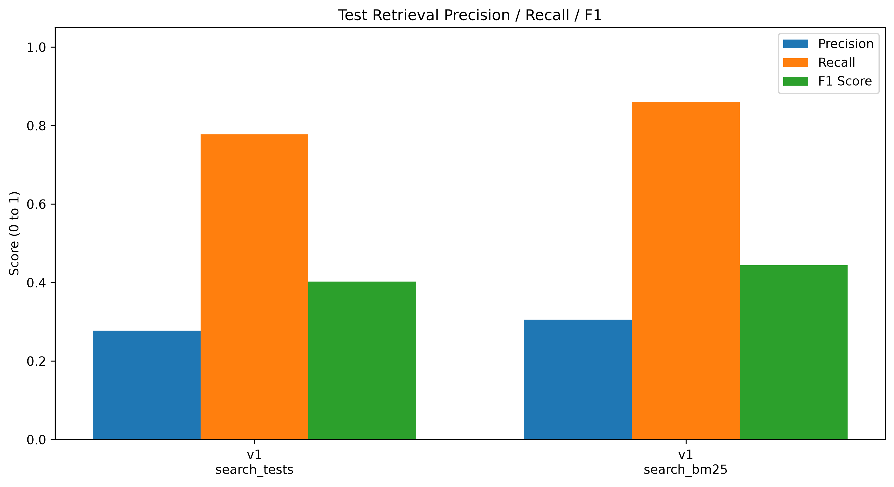

# Version 1 mock run results (2026-10-18)

> **This is a mock run.** Its purpose is to test the pipeline end to end: criteria → test search →
> AI verdict → scoring → charts. The answer key does not have `partial` cases yet: every case is
> labelled only `covered` or `not_covered`, so any `partial` answer counts as wrong. The scores
> below show that the pipeline works and where it fails, not how good the tool is.

## What we ran

| | |
|---|---|
| Cases | 24: 12 acceptance criteria (Sammi's, `data/cases.jsonl`) × 2 copies (`covered`, `not_covered`), across the 10 dev issues |
| Model | `gpt-6-luna` (OpenAI) |
| Prompt | `prompts/verdict_v1.txt`: one AI call per case, shown the top 3 tests from search |
| Searches | Embedding search (`search_tests`) and keyword search (`search_bm25`), one run each |
| Answer key | `data/labels_v1.jsonl`, matched by issue + copy |
| Files | `results/v1_mock_embedding.jsonl`, `results/v1_mock_bm25.jsonl` (AI answers); `results/*_metrics.csv` (scores); `results/comparison_*.png` (charts) |
| Cost | About 1 US cent per run (about 12,400 input and 6,300 output tokens) |

To reproduce:
```bash
python src/run_v1.py --out results/v1_mock_embedding.jsonl
python src/run_v1.py --search search_bm25 --out results/v1_mock_bm25.jsonl
python src/evaluation/evaluate.py results/v1_mock_embedding.jsonl
python src/evaluation/evaluate.py results/v1_mock_bm25.jsonl
python src/evaluation/plot_metrics.py results/v1_mock_embedding_metrics.csv results/v1_mock_bm25_metrics.csv
```

## Results

| Metric | Embedding search | Keyword search | What it means |
|---|---|---|---|
| Verdict accuracy | **0.375** (9 / 24) | **0.417** (10 / 24) | Share of cases with the right answer |
| – on `covered` copies | 5 / 12 | 4 / 12 | Tests are there: did it say covered? |
| – on `not_covered` copies | 4 / 12 | 6 / 12 | Tests removed: did it say not covered? |
| False all-clear rate | **0.000** | **0.000** | Said `covered` when the tests were removed (the most harmful mistake) |
| False alarm rate | 0.042 (1 case) | 0.000 | Said `not_covered` when the tests were there |
| Test recall | 0.778 | 0.861 | Share of the right tests found in the top 3 (covered copies only) |
| Test precision | 0.278 | 0.306 | Share of the 3 tests shown that are right |
| Answers given | covered 5, not_covered 5, **partial 14** | covered 4, not_covered 6, **partial 14** | |




## How to read the numbers

- **Accuracy is low mainly because of `partial`.** The AI answered `partial` in 14 of 24 cases with
  either search. Version 1's answer key has no `partial`, so all 14 count as wrong.
- **No false all-clears.** The AI never called a requirement tested when its tests had been removed.
  This is the most important safety property, and it held in both runs.
- **Precision is low by design.** Search always shows 3 tests and usually only 1 is the right one,
  so precision is at most about 0.33. Recall matters more: did the right test reach the AI?
- **The two searches perform about the same.** They gave different answers on only 4 of 24 cases,
  and the accuracy gap is 1 case. The recall gap comes from one case (1635 ac1), where keyword search
  found the right test and embedding search did not. The AI's answers also vary between runs, so a
  1-case gap could flip on a rerun.

## Failures observed

1. **`partial` is overused (14 / 24).** The AI's reasons show two patterns:
   - **The criterion asks for more than the tests check.** For 1142, the criterion says the request is
     "prepared and sent", but the test only prepares it, so the AI says `partial`. The same happens for
     2931 (the test checks the body type, not the exact bytes).
   - **On `not_covered` copies, related tests count as partial evidence.** E.g. "these tests send GET
     requests but none checks Content-Length" → `partial`, when the answer should be `not_covered`.
2. **1635 ac1 (covered copy) answered `not_covered`** with embedding search: no single test it was shown
   combined cookies passed in the call with a redirect. Keyword search found the right test.
3. **4718 (covered copy): right verdict, different test.** Embedding search found
   `test_auth_is_stripped_on_http_downgrade` and the AI correctly said `covered`, but the answer key
   lists a different test, so recall is 0. The answer key may need a second accepted test here.
4. **Mixed test-id formats in `tests_used`.** The AI sometimes cites short names (`test_binary_put`)
   and sometimes full pytest ids. Scoring uses `tests_found` from search, so the scores are unaffected.

## Next steps

1. **`prompts/verdict_v2.txt`** (Sammi): define `partial` strictly. It means at least one test checks part
   of the requirement; related tests that check something else mean `not_covered`. Ask for full
   pytest ids in `tests_used`.
2. **Criteria wording** (Sammi): check whether criteria like 1142 ("prepared and sent") ask for more
   than the issue needs.
3. **Answer key** (Xiaoning): check 4718's accepted tests, then add `partial` labels per criterion
   after the checkpoint.
4. **Rerun** both searches with `verdict_v2` (Gabriel), twice each to see how much answers vary, then
   decide the default search.
5. **Test set:** freeze the prompt, then run once on the separate test issues for the reported results.
